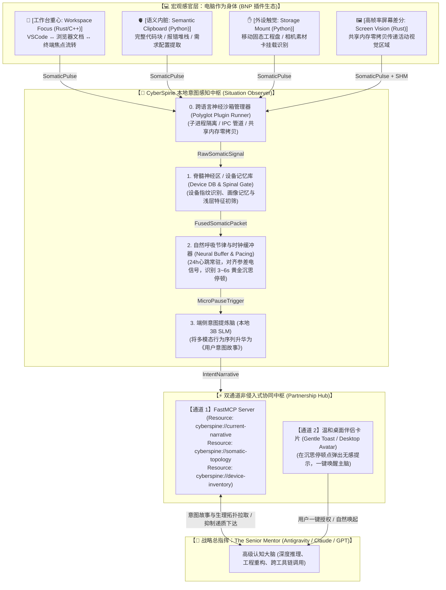

# 系统详细架构与接口协议规范 (System Architecture & Protocol Spec)

**版本**：v3.2.0 (意图感知、通用跨语言神经协议 BNP、全组件蓝图与双通道协同定稿版)  
**核心定位**：“身旁坐着一位懂你节奏的大佬搭档 (The Silent Senior Partner)”——端侧宏观感知、自然节律聚合与 MCP 意图故事共鸣中枢。  
**状态**：工程基准定稿 (Approved for Implementation)  

---

## 1. 核心架构全景：意图观察者与双 Agent 协同

`CyberSpine` 的本质不是操作系统的机械探针，而是为顶级 AI 赋予的 **“伴随式观察直觉与意图共鸣中枢 (Situation & Intent Observer)”**。

### 1.1 认知科学架构全景



---

## 2. 核心设计哲学：从“机械探针”到“意图观察员”

| 维度 | **传统机械监听器 (Mechanical Probe)** | **CyberSpine 意图观察员 (The Silent Partner)** |
| :--- | :--- | :--- |
| **观察粒度** | 监听微观物理报文（按键、单文件写入） | 捕捉宏观行为流转（工作台重心、报错捕获、工程挂载） |
| **时延与节奏** | 追求毫秒级机械硬实时 | 允许 **3~6 秒自然呼吸节律 (Micro-Pause)**，在用户沉思停顿时从容介入 |
| **向上汇报** | 冰冷离散的驱动事件（Events） | 饱含智慧与情境的 **《用户意图故事 (Intent Narrative)》** |
| **人机交互** | 频繁弹窗打扰，破坏专注心流 | **不吵不闹、恰到好处**，只在用户遇到瓶颈停顿时伸出援手 |
| **待机能耗** | 高频门控消耗 CPU/GPU | 基于宏观事件驱动，平时 **0% CPU 占用，内存 < 60MB** |
| **隐私保护** | 原始数据直接上传云端 | **端侧 3B SLM 本地闭环脱敏**，原始日志绝不出本机 |

---

## 3. 通用跨语言神经末梢协议 (Biomimetic Nerve Protocol - BNP v1.0)

为了实现像 **Chrome 扩展** 或 **VSCode 插件** 一样即插即拔的极高扩展性，CyberSpine 制定了语言中立的 **BNP v1.0 协议**。

### 3.1 跨语言沙箱隔离架构 (Polyglot Sandbox)
* **主中枢 (Python)**：负责调度编排、时间对齐、对接本地 3B SLM 与 MCP 协议；
* **末梢插件 (Python / Rust / C++ / Go / Node.js)**：作为独立的操作系统子进程（Subprocess）运行，通过标准 IPC（命名管道 / Stdio）与中枢通信；
* **物理崩溃隔离**：任一第三方插件发生段错误或内存溢出，仅该插件子进程终止，中枢神经 100% 安全并不受影响，支持自动热重启。

### 3.2 插件元数据清单规范 (`manifest.json`)
每个末梢插件必须在根目录提供一份 `manifest.json`：

```json
{
  "nerve_id": "nerve.vision.screen_diff",
  "name": "Screen Diff Vision Perceptor",
  "version": "1.0.0",
  "author": "CyberSpine Community",
  "category": "VISION",
  "description": "基于 Rust 硬件加速的高性能屏幕差分与活跃窗口感知",
  "entrypoint": "bin/screen_worker.exe",
  "transport": "NAMED_PIPE",
  "permissions": [
    "PERM_SCREEN_CAPTURE",
    "PERM_FOREGROUND_WINDOW"
  ],
  "default_config": {
    "fps_limit": 10,
    "diff_threshold": 0.05
  }
}
```

### 3.3 双通道传输：控制面 JSON + 数据面共享内存 (Zero-Copy SHM)
* **低吞吐感官（IO/文件/焦点）**：直接通过命名管道/IPC 发送标准结构化 JSON 消息；
* **极高吞吐感官（4K 60fps 屏幕差分 / 原始音频流）**：
  * 控制面：仅通过管道传输 100 字节轻量元数据（`frame_id`, `diff_rect`, `shm_key`）；
  * 数据面：底层图像写入 Windows 命名共享内存（`Memory-Mapped File`），中枢按需零拷贝读取，物理 CPU 占用趋近于 0，传输耗时 $\le 3\text{ms}$。

### 3.4 插件标准生命周期状态机
```
     中枢 (CyberSpine Core)                       插件子进程 (Nerve Plugin)
               │                                              │
               │────── 1. init(config, handshake_pipe) ──────►│ (初始化底层钩子)
               │◄───── 2. ready(supported_features) ──────────│
               │                                              │
               │────── 3. start_streaming() ─────────────────►│ (开始发射电信号)
               │◄───── 4. stream_pulse(SomaticPulse) ─────────│ (持续推送宏观观察)
               │                                              │
               │────── 5. pause() / resume() ────────────────►│ (中枢动态节能调控)
               │────── 6. shutdown() ────────────────────────►│ (释放硬件句柄优雅退出)
```

---

## 4. 四大核心组件架构与工程实现蓝图

```
CyberSpine/
├── src/
│   ├── models/                  # 核心契约与数据模型
│   │   ├── somatic_signals.py   # 设备指纹、原始电信号、脉冲、意图故事模型
│   │   └── messages.py          # 双 Agent A2A 消息通信协议契约
│   ├── perceptors/              # 组件 1: 宏观感官适配层 (低频低载)
│   │   ├── io/                  # 全机 IO 神经末梢
│   │   │   ├── device_db.py     # 设备指纹记忆库 (SHA-256 设备画像)
│   │   │   ├── storage_probe.py # 存储介质浅层安全嗅探器 (MaxDepth=2, <=2.1ms)
│   │   │   └── io_manager.py    # IO 末梢总控管理器 (拓扑快照与信号生成)
│   │   ├── workspace_focus.py   # [工作区] 前台焦点进程与标题流转感知
│   │   └── semantic_clip.py     # [剪贴板] 代码块与长篇报错堆栈语义提取
│   ├── pacing/                  # 组件 2: 中枢时钟缓冲与心跳机
│   │   ├── neural_buffer.py     # 24h 常驻异步缓冲池 (多信号时空对齐与防抖)
│   │   └── pause_detector.py    # 专注流 (Flow) vs 沉思停顿 (3~6s Micro-Pause) 检测
│   ├── spinal_core/             # 组件 3: 脊髓神经区 / 意图提炼脑
│   │   ├── intent_gate.py       # 意图审查与低级过滤门控
│   │   ├── ollama_client.py     # 本地 3B SLM 客户端 (Qwen2.5-3B)
│   │   └── narrative_builder.py # 生成《用户意图故事 (Intent Narrative)》
│   ├── cortex/                  # 组件 4: 前额叶大脑与双向闭环
│   │   ├── master_cortex.py     # 3W 深度推演、温和交互卡片与双手执行
│   │   └── efferent_feedback.py # 下行抑制递质下达 (suppress_and_observe)
│   └── mcp_bridge/              # FastMCP Server 协议通道
│       ├── server.py            # FastMCP Server (Resources & Tools)
│       └── toast_bridge.py      # Windows 原生温和通知气泡
├── plugins/                     # 外部可插拔 BNP 神经插件目录
├── tests/                       # 单元测试与端到端闭环验证套件
└── demo_minimal_loop.py         # 端到端自测演练主入口
```

---

## 5. 核心数据结构与接口契约 (Pydantic Models)

### 5.1 硬件设备指纹与画像 (`DeviceFingerprint`)
```python
from datetime import datetime, timezone
from enum import Enum
from typing import Any, Dict, List, Optional
from pydantic import BaseModel, Field

def utc_now() -> datetime:
    return datetime.now(timezone.utc)

class DeviceClass(str, Enum):
    STORAGE_REMOVABLE = "STORAGE_REMOVABLE"    # 可移动存储介质 (U盘、移动硬盘、SD卡)
    STORAGE_FIXED = "STORAGE_FIXED"            # 本地固定磁盘
    NETWORK_INTERFACE = "NETWORK_INTERFACE"    # 网络接口 (以太网、WiFi、蜂窝)
    USB_PERIPHERAL = "USB_PERIPHERAL"          # USB 通用外设 (手柄、采集卡、扩展坞)
    AUDIO_DEVICE = "AUDIO_DEVICE"              # 音频设备 (耳机、麦克风)
    BLUETOOTH_DEVICE = "BLUETOOTH_DEVICE"      # 蓝牙外设

class DeviceFingerprint(BaseModel):
    """硬件设备指纹与画像"""
    device_id: str = Field(description="全局唯一设备指纹哈希 (SHA256)")
    device_class: DeviceClass
    vendor_id: Optional[str] = None
    product_id: Optional[str] = None
    volume_label: Optional[str] = None
    serial_number: Optional[str] = None
    total_capacity_gb: Optional[float] = None
    free_capacity_gb: Optional[float] = None
    mount_point: Optional[str] = None
    tags: List[str] = Field(default_factory=list, description="历史画像标签 (如 ['WORK_PYTHON_REPO'])")
    first_seen: datetime = Field(default_factory=utc_now)
    last_seen: datetime = Field(default_factory=utc_now)
    is_known: bool = Field(default=False, description="是否为数据库中已认识的熟客设备")
```

### 5.2 统一神经电信号脉冲 (`SomaticPulse`)
```python
class SomaticChannel(str, Enum):
    WORKSPACE = "WORKSPACE"      # 工作区重心流转 (VSCode, Browser, Terminal)
    CLIPBOARD = "CLIPBOARD"      # 语义剪贴板 (报错堆栈, 代码块)
    STORAGE = "STORAGE"          # 生产力存储介质 (项目硬盘, 相机卡)
    VISION = "VISION"            # 高速视觉差分 (屏幕活动区域)
    AUDITION = "AUDITION"        # 语音活动与环境声音

class SomaticPulse(BaseModel):
    """跨语言标准神经电脉冲帧"""
    pulse_id: str = Field(description="脉冲全局唯一 UUID")
    nerve_id: str = Field(description="来源插件 ID (如 nerve.storage.io)")
    channel: SomaticChannel
    observed_at: datetime = Field(default_factory=utc_now)
    headline: str = Field(description="宏观事件一句话概括，如 'USB_PROJECT_ATTACHED'")
    semantic_context: Dict[str, Any] = Field(default_factory=dict, description="结构化轻量元数据")
    shm_handle: Optional[str] = Field(None, description="共享内存句柄 (重量级图像/音频零拷贝指针)")
```

### 5.3 行为片段与呼吸节律停顿 (`BehavioralEpisode` & `PacingStateEnum`)
```python
class PacingStateEnum(str, Enum):
    FLOW_ACTIVE = "FLOW_ACTIVE"          # 用户正在连贯操作，静默记录不打扰
    MICRO_PAUSE = "MICRO_PAUSE"          # 关键操作后停顿 3~6 秒，黄金介入契机
    IDLE_STANDBY = "IDLE_STANDBY"        # 长时间无操作，完全休眠

class BehavioralEpisode(BaseModel):
    """一个连贯的用户操作行为序列"""
    episode_id: str
    started_at: datetime
    last_action_at: datetime
    pulses: List[SomaticPulse]
    pacing_state: PacingStateEnum
    pause_duration_seconds: float = 0.0
```

### 5.4 终极产物：《用户意图故事》 (`IntentNarrative`)
端侧 3B SLM 产出的不是离散变量，而是一份富有智慧的情境叙事：

```python
class IntentNarrative(BaseModel):
    """呈递给战略主脑的完整用户意图故事"""
    narrative_id: str
    generated_at: datetime = Field(default_factory=utc_now)
    macro_scenario: str = Field(description="宏观情境，如 'ASYNC_DEV_DEBUGGING' | 'PROJECT_INIT'")
    confidence: float = Field(ge=0.0, le=1.0, description="置信度 (0.0~1.0)")
    situation_story: str = Field(description="人话叙述当前用户的行为轨迹与遭遇的卡点")
    intent_hypothesis: str = Field(description="推测用户接下来想要达成的核心意图")
    suggested_partnership: str = Field(description="建议战略主脑以何种方式温和介入协助")
    evidence_snapshot: Dict[str, Any] = Field(description="关联的宏观感官快照")
```

### 5.5 双 Agent 交互与下行抑制协议 (`CognitiveFeedbackMessage`)
```python
class FeedbackDirective(str, Enum):
    SUPPRESS_AND_OBSERVE = "SUPPRESS_AND_OBSERVE"  # 下行抑制：保持静默，进入观察冷却
    PROCEED_COGNITION = "PROCEED_COGNITION"        # 前额叶接管：发起对话或执行动作
    MODIFY_ATTENTION = "MODIFY_ATTENTION"          # 动态调控：调整特定感官的灵敏度

class CognitiveFeedbackMessage(BaseModel):
    """主脑向脊髓中枢传达的神经调节指令"""
    feedback_id: str
    target_narrative_id: str
    directive: FeedbackDirective
    cooldown_seconds: int = 300
    reason: str = Field(description="决策理由，如 '用户处于疲惫期，避免打扰'")
```

---

## 6. FastMCP 协议接口规范

CyberSpine 作为标准 FastMCP Server 运行，为战略主脑提供以下专属资源与工具：

### 6.1 MCP Resources (意图与身体拓扑订阅)
* `cyberspine://current-narrative`：主脑可随时拉取当前最新、最鲜活的《用户意图故事》；
* `cyberspine://somatic-topology`：主脑拉取当前电脑的全局物理身体图谱（屏幕数量、挂载设备、前台主工作台、网络状态）；
* `cyberspine://device-inventory`：主脑查询已知设备指纹记忆库。

### 6.2 MCP Tools (搭档协同工具)
* `acknowledge_assistance(narrative_id: str, status: str)`：主脑标记已对该意图提供协助；
* `suppress_feedback(scope: str, timeout_seconds: int = 5)`：主脑在执行批量文件修改前发送自身动作副本，抑制感官回声；
* `adjust_sensory_gate(channel: str, sensitivity: float)`：主脑动态调控下层特定感官的门控灵敏度。

---

## 7. 防打扰状态机、打扰度评分模型与冷却算法 (Anti-Fatigue)

为了彻底根除“大眼夹（Clippy）”诅咒，CyberSpine 引入了多维防打扰评分模型：

$$\text{IntrusionScore} = \text{Confidence} \times W_{\text{pacing}} \times (1 - \text{FatiguePenalty})$$

1. **心流保护状态机**：
   * 当检测到前台按键或打字处于连续密集状态时，静默率为 **100%**；
   * 只有进入 **3~6 秒黄金沉思停顿点 (Micro-Pause)** 时，门控开关才允许打开。
2. **动态自适应冷却 (Dynamic Cooldown)**：
   * 同一宏观场景在用户拒绝后，自动进入 **15~30 分钟自适应指数退避冷却**，绝不进行连续重复询问。
