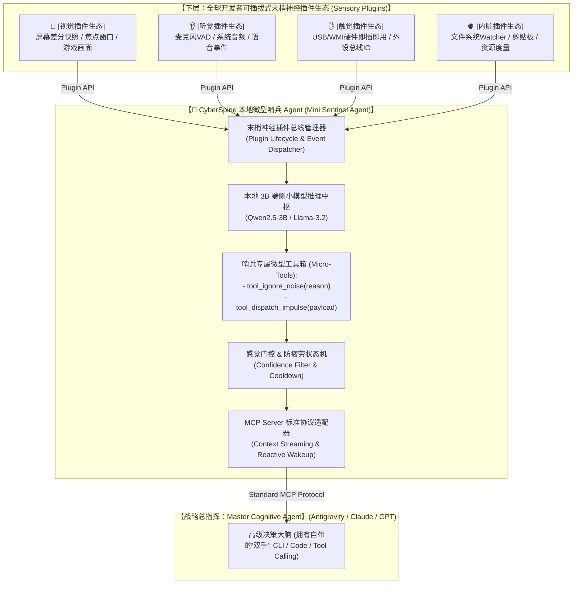

# 三层系统架构与插件协议规范 (System Architecture & Plugin Spec)

**版本**：v2.1.0 (双 Agent 协同与微型哨兵架构定稿)  
**状态**：架构基准最终定稿  

---

## 1. 核心架构全景：微内核与开放神经生态

`CyberSpine` 的本质是一个 **“本地常驻微型哨兵 Agent（Mini Sentinel Agent）”**，它构成了操作系统与高级认知大脑之间的**双 Agent 协同系统（Dual-Agent Architecture）**：

* **微型哨兵 Agent (CyberSpine)**：负责 24 小时在端侧站岗，通过开放插件统领感官，利用本地 3B SLM 进行感觉门控（过滤 99.9% 噪音与脱敏）；
* **战略主脑 Agent (Antigravity / Claude / Codex)**：负责在收到高价值神经信号后出击，利用自身强大的“双手（工具链/代码重构）”为用户解决复杂问题。



---

## 2. 双 Agent 协同机制与工作职责

| 架构层级 | **本地微型哨兵 Agent (CyberSpine)** | **战略主脑 Agent (Master Agent)** |
| :--- | :--- | :--- |
| **角色隐喻** | **脊髓神经 / 24小时值班特战前哨** | **前额叶大脑 / 战略决策总指挥部** |
| **算力载体** | 本地 3B~5B 轻量 SLM（~2GB 显存，0 算力费用） | 万亿参数顶级云端模型（按需唤醒） |
| **核心职责** | 统筹底层插件、多模态特征融合、感觉门控、防打扰 | 深度长程推理、跨工具链编排、精准代码修改、人机交互 |
| **运行机制** | 纯事件驱动，平时 0% 空闲 CPU | 收到结构化神经冲动后主动介入 |

---

## 3. 本地微型哨兵 Agent 的工具闭环 (Mini-Agent Tools)

本地 3B 小模型不需要处理复杂业务逻辑，它的 Prompt 与工具极其聚焦：

```yaml
# 本地哨兵 Agent 的系统设定
角色: CyberSpine 操作系统状态感知哨兵
使命: 监听来自末梢神经插件的原始信号，过滤琐碎无用噪音，仅在发现高价值任务时向主脑发射神经电冲动。
可用工具:
  - name: tool_ignore_noise
    description: 判定当前事件为无意义系统噪音 (如临时文件写入、单字复制)，静默丢弃。
    parameters:
      reason: string

  - name: tool_dispatch_impulse
    description: 判定为高价值协作情境，组装结构化上下文并上报给主脑 Agent。
    parameters:
      intent_category: string  # "PROJECT_WORKSPACE" | "CODE_ERROR" | "DATA_PIPELINE"
      confidence: float        # 置信度
      context_summary: string   # 脱敏后的情境摘要
      suggested_action: string  # 建议主脑发起的行动
```

---

## 4. 开放末梢神经插件开发规范 (Peripheral Plugin SDK)

开发者只需实现标准的 `BaseNervePlugin` 接口，即可为 CyberSpine 打造专属感官：

```python
from abc import ABC, abstractmethod
from typing import Dict, Any, AsyncGenerator

class NerveImpulse:
    """标准神经冲动信号定义"""
    sensor_type: str        # "VISION" | "AUDITION" | "TACTILE" | "VISCERAL"
    event_name: str         # 例如: "USB_MOUNTED", "SCREEN_CHANGE", "AUDIO_VAD"
    confidence: float       # 局部置信度 (0.0 ~ 1.0)
    raw_payload: Dict[str, Any]  # 原始特征元数据 (脱敏数据)

class BaseNervePlugin(ABC):
    """末梢神经插件基类"""
    
    @abstractmethod
    async def initialize(self, config: Dict[str, Any]) -> bool:
        """插件初始化 (注册硬件钩子或操作系统监听器)"""
        pass

    @abstractmethod
    async def listen(self) -> AsyncGenerator[NerveImpulse, None]:
        """异步事件生成器：向脊髓微内核持续发送神经电信号"""
        pass

    @abstractmethod
    async def shutdown(self) -> None:
        """释放底层系统资源"""
        pass
```

---

## 5. 向上 MCP 通信协议规范 (Upward MCP Interface)

CyberSpine 作为标准 **MCP (Model Context Protocol) Server** 运行，暴露以下标准端点：

### 5.1 MCP Resources & Subscriptions (上下文订阅)
* `cyberspine://somatic-state`：大脑 Agent 可随时读取当前的全身感官综合状态与硬件拓扑。

### 5.2 MCP Prompts / Reactive Notifications (神经电信号上涌)
当感觉门控判定置信度达标且脱离冷却期时，通过 MCP 协议主动向主脑推送结构化通知：

```json
{
  "jsonrpc": "2.0",
  "method": "notifications/cyberspine/impulse",
  "params": {
    "impulse_id": "impulse_20260827_001",
    "fusion_category": "PROJECT_WORKSPACE_MOUNTED",
    "confidence": 0.98,
    "context_summary": "用户接入了包含 Python 研发项目的移动固态硬盘 (E:)，当前前台活跃窗口为 VSCode",
    "active_sensors": ["TACTILE_WMI", "VISCERAL_FILESYSTEM", "VISION_FOCUS"],
    "suggested_action": "主动询问是否需要扫描项目依赖并初始化运行环境"
  }
}
```

---

## 6. 架构核心价值优势总结

1. **极致轻量，开发难度极低**：核心只是一个仅需数百行代码的本地微型哨兵 Agent，完全支持纯 Vibe Coding 快速实现；
2. **生态级扩展力**：全球开发者可以自由编写 `cyberspine-plugin-wmi`、`cyberspine-plugin-audio` 等专属感官；
3. **完全自主掌控**：用户根据硬件配置与隐私诉求，自由选配 AI 的“眼睛、耳朵与内脏”！
