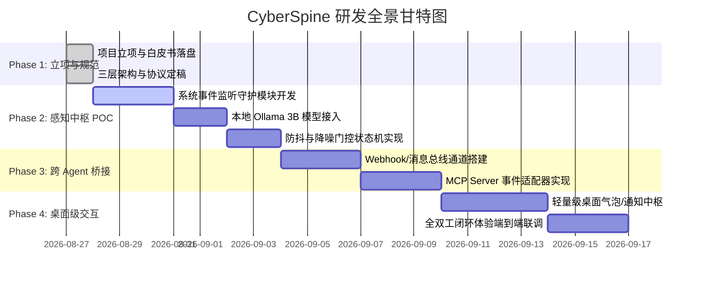

# 工程研发路线图与里程碑 (Engineering Roadmap & Milestones)

**项目名称**：CyberSpine (赛博脊椎)  
**当前版本**：v0.1.0-alpha  

---

## 阶段规划总览

---

## 各阶段详细里程碑 (Milestones)

### 🚩 Milestone 1: 立项设计与协议规范 (Phase 1) - 【已完成】
* [x] 项目基础骨架创建与命名定案 (`ambient-sentinel`)
* [x] 撰写项目立项白皮书 (`PROJECT_PROPOSAL.md`)
* [x] 确立三层分工系统架构与 JSON 通信协议规范 (`ARCHITECTURE.md`)
* [x] 制定工程研发路线图 (`ROADMAP.md`)

---

### 🚩 Milestone 2: 神经末梢与本地感知核心 (Phase 2) - 【下一阶段】
* [ ] **系统事件监听器开发**：
  * [ ] 编写 Windows WMI 硬件插拔（USB/存储）监听脚本
  * [ ] 编写 `watchdog` 目录变动监听（Downloads / Workspace 监测）
  * [ ] 编写剪贴板文本格式监听与防抖处理
* [ ] **本地 SLM 推理客户端集成**：
  * [ ] 适配 Ollama / llama.cpp REST 接口
  * [ ] 调优 Qwen2.5-3B-Instruct 意图分类与 JSON 提取 Prompt
* [ ] **降噪与防疲劳门控**：
  * [ ] 实现冷却时间（Cooldown）与置信度过滤逻辑

---

### 🚩 Milestone 3: 跨 Agent 通信与主 Agent 协同 (Phase 3)
* [ ] 编写跨 Agent 消息总线适配器（支持 Ingress Webhook）
* [ ] 封装标准 **MCP (Model Context Protocol) Server**，提供系统事件流订阅
* [ ] 联调 Antigravity 主 Agent 的反应式唤醒（Reactive Wakeup）

---

### 🚩 Milestone 4: 桌面轻量交互与体验闭环 (Phase 4)
* [ ] 开发极轻量的 Windows 桌面悬浮气泡 / 系统通知栏组件
* [ ] 端到端全流程测试（U 盘插拔 $\rightarrow$ 本地 3B 感知 $\rightarrow$ 主 Agent 拟定方案 $\rightarrow$ 用户一键授权执行）
* [ ] 性能压测与空闲资源消耗优化
