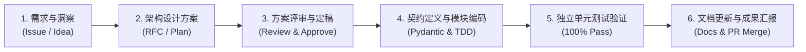

# 软件开发全流程规划与协作治理规范 (Development Workflow & Governance)

**文档编号**：DOC-DEV-001  
**状态**：团队工程基准 (Approved)  
**维护者**：CyberSpine 架构委员会  

---

## 1. 核心研发原则：讨论优先，严禁抢跑 (Plan before Code)

CyberSpine 作为一套严谨的仿生系统工程，任何一次代码变更都可能影响跨脑区协作逻辑。

**全团队必须严格遵守以下四大研发纪律**：
1. **方案与架构主导**：针对任何新增模块、重构或协议改动，必须先在 `docs/` 或 Issue 中深入讨论技术方案与接口数据契约；
2. **绝对禁止盲目抢跑**：在方案未经充分讨论、审查并达成共识前，**绝对不直接写下任何生产代码**；
3. **一次只跑通一个组件的完整闭环 (One Component at a Time)**：拒绝“上来就想一口吃成胖子”，严格按照“单个组件开发 ➔ 独立单元测试 ➔ 100% 验证通过 ➔ 下一组件”的节奏稳步推进；
4. **测试与文档同步落盘 (Docs & Tests First)**：功能落地必须伴随完备的单元测试用例与开发文档更新。

---

## 2. 标准特性研发全生命周期 (Feature Lifecycle)



### 阶段 1：需求发起与痛点定义 (Inception)
* 在 GitHub Issues 或产品规划池中发起需求，明确：
  * 该功能属于哪一个脑区（前额叶 / 丘脑小脑 / 脑干 / 脊髓末梢）；
  * 生物学隐喻与实际解决的用户痛点；
  * 性能约束（CPU 占用、内存上限、推理耗时）。

### 阶段 2：技术实施方案制定 (Implementation Plan)
* 创建或更新 `implementation_plan.md`；
* 详细规划数据契约模型、依赖变动、涉及文件清单（`[NEW]`, `[MODIFY]`, `[DELETE]`）；
* 制定包含边界条件与异常场景的验证测试计划（Verification Plan）。

### 阶段 3：方案评审与定稿 (Approval Gate)
* 架构师与用户（PO）共同审阅实施方案，消除模糊需求与潜在设计冲突；
* 明确批准后方可进入代码编写。

### 阶段 4：测试驱动与模块落地 (Implementation)
* 先定义 Pydantic 数据结构契约；
* 编写核心业务逻辑，遵循严格的只读浅层探测与 0% 能耗准则；
* 编写 `tests/test_component_*.py` 独立单元测试套件。

### 阶段 5：自动化回归与全量验证 (Verification)
* 在纯净环境下执行全量单元测试与基准测试；
* 验证跨平台终端编码兼容性、时区感知与物理资源消耗。

### 阶段 6：文档同步与版本固化 (Documentation & Merge)
* 同步更新 `walkthrough.md`、架构文档与路线图；
* 提交 Git Commit 并发起 Pull Request。

---

## 3. 跨语言末梢插件研发流程

针对由社区开发者贡献的外部 BNP 神经插件（如 Rust 视觉探针、Go 网络探针），采用独立沙箱分支开发流：

```
主仓库 CyberSpine (Core)
  │
  ├── 1. 开发者 Fork 仓库并在 `plugins/nerve_xxx/` 创建独立目录
  ├── 2. 编写 `manifest.json` 与插件入口二进制
  ├── 3. 运行内置 `PluginRunner` 进行本地 IPC 握手联调
  └── 4. 提交包含自测脚本的独立 PR，合并至官方插件库
```

---

## 4. 交付质量红线

| 维度 | 交付红线标准 |
| :--- | :--- |
| **单元测试覆盖率** | 核心数据流与状态机分支覆盖率 $\ge 90\%$ |
| **测试执行耗时** | 单组件独立测试总耗时 $\le 1.0$ 秒 |
| **代码规范与类型** | 100% 启用 Python 类型注解 (`Type Hints`) 与 Pydantic V2 校验 |
| **文档一致性** | 任何数据结构变动必须在同一 PR 中同步更新架构文档与中英文 README |
